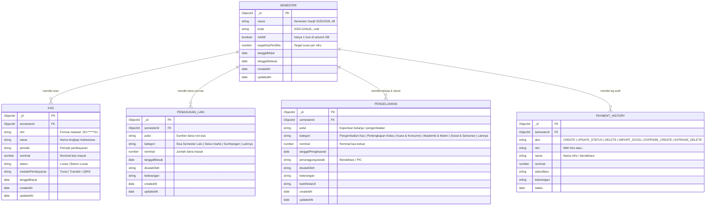

# 🗄️ Database Architecture, Schemas & Integrity Rules (`db.md`)

Dokumen spesifikasi arsitektur basis data MongoDB (Mongoose) untuk aplikasi **KasKita**. Dokumen ini mencakup model multi-semester, pencatatan kas mahasiswa, pemasukan non-kas, **pengeluaran kas kelas (termasuk modul Pengembalian Kas / Refund - Opsi 1)**, dan log riwayat audit transaksi.

---

## 📌 Ringkasan Solusi: Pengembalian Kas via Modul Pengeluaran (Opsi 1)

Sesuai kesepakatan **Opsi 1 (Paling Simpel & Standar Pembukuan Kas)**:
* Uang kas yang dibagikan/dikembalikan ke mahasiswa di akhir semester dicatat resmi ke dalam koleksi **`Pengeluaran`** dengan kategori khusus: **`"Pengembalian Kas"`**.
* **Keuntungan Arsitektural**:
  1. **Tidak merusak atau mengubah struktur koleksi `Kas`** yang sudah rapi mencatat pembayaran mahasiswa.
  2. **Buku kas kronologis balance 100%**: Setiap rupiah yang keluar dari kas fisik bendahara tercatat sebagai arus kas keluar (`Cash Out`).
  3. **Saldo kas di frontend otomatis presisi**:
     * **Semester Ganjil 2025/2026**: Masuk $\text{Rp}2.470.000$ $-$ Belanja $\text{Rp}1.151.000$ $-$ Pengembalian $\text{Rp}1.319.000$ = **Saldo Kas $\text{Rp}0$** *(selesai & balance)*.
     * **Semester Genap 2025/2026**: Masuk $\text{Rp}1.825.000$ $-$ Belanja $\text{Rp}1.265.000$ $-$ Pengembalian $\text{Rp}470.000$ = **Saldo Kas $\text{Rp}90.000$** *(pas dengan saldo awal yang dialihkan ke Semester 3)*.
     * **Semester Ganjil 2026/2027 (Aktif)**: Saldo Awal $\text{Rp}90.000$ + Kas Mhs $\text{Rp}330.000$ $-$ Belanja $\text{Rp}271.000$ = **Saldo Kas $\text{Rp}149.000$**.

---

## 1. Diagram Relasi Entitas (ERD)



---

## 2. Definisi Skema Mongoose (`src/models/`)

### A. Model Semester (`src/models/Semester.js`)
```javascript
const mongoose = require("mongoose");

const semesterSchema = new mongoose.Schema(
  {
    nama: {
      type: String,
      required: [true, "Nama semester wajib diisi"],
      trim: true,
    },
    kode: {
      type: String,
      required: [true, "Kode semester wajib diisi"],
      unique: true,
      trim: true,
      uppercase: true,
    },
    isAktif: {
      type: Boolean,
      default: false,
      index: true,
    },
    targetKasPerMhs: {
      type: Number,
      required: [true, "Target kas per mahasiswa wajib diisi"],
      min: [0, "Target kas tidak boleh negatif"],
      default: 0,
    },
    tanggalMulai: {
      type: Date,
      required: [true, "Tanggal mulai wajib diisi"],
    },
    tanggalSelesai: {
      type: Date,
      required: [true, "Tanggal selesai wajib diisi"],
    },
  },
  { timestamps: true }
);

module.exports = mongoose.models.Semester || mongoose.model("Semester", semesterSchema);
```

---

### B. Model Kas Mahasiswa (`src/models/Kas.js`)
```javascript
const mongoose = require("mongoose");

const kasSchema = new mongoose.Schema(
  {
    semesterId: {
      type: mongoose.Schema.Types.ObjectId,
      ref: "Semester",
      required: [true, "Semester wajib ditentukan"],
      index: true,
    },
    nim: {
      type: String,
      required: [true, "NIM wajib diisi"],
      trim: true,
    },
    nama: {
      type: String,
      required: [true, "Nama wajib diisi"],
      trim: true,
    },
    periode: {
      type: String,
      required: [true, "Periode wajib diisi"],
      trim: true,
    },
    nominal: {
      type: Number,
      required: [true, "Nominal wajib diisi"],
      min: [0, "Nominal tidak boleh negatif"],
    },
    status: {
      type: String,
      required: [true, "Status wajib diisi"],
      enum: {
        values: ["Lunas", "Belum Lunas"],
        message: "Status harus Lunas atau Belum Lunas",
      },
    },
    metodePembayaran: {
      type: String,
      enum: ["Transfer", "QRIS", "Tunai"],
      default: "Tunai",
    },
    tanggalBayar: {
      type: Date,
      default: Date.now,
    },
  },
  { timestamps: true }
);

kasSchema.index({ semesterId: 1, nim: 1, periode: 1 });

module.exports = mongoose.models.Kas || mongoose.model("Kas", kasSchema);
```

---

### C. Model Pengeluaran Kas (`src/models/Pengeluaran.js`)
> [!IMPORTANT]
> Enum `kategori` diperbarui dengan menambahkan nilai **`"Pengembalian Kas"`** untuk mengakomodasi pencatatan pembagian uang kas kembali ke mahasiswa (Opsi 1).

```javascript
const mongoose = require("mongoose");

const VALID_KATEGORI_PENGELUARAN = [
  "Pengembalian Kas",       // BARU: Pengembalian sisa kas ke mahasiswa di akhir semester
  "Perlengkapan Kelas",     // Spidol, kabel, colokan, pengharum
  "Acara & Konsumsi",       // Air minum dosen, konsumsi rapat
  "Akademik & Materi",      // Print absen, fotokopi materi
  "Sosial & Santunan",      // Sumbangan teman sakit/duka
  "Lainnya",
];

const pengeluaranSchema = new mongoose.Schema(
  {
    semesterId: {
      type: mongoose.Schema.Types.ObjectId,
      ref: "Semester",
      required: [true, "Semester wajib ditentukan"],
      index: true,
    },
    judul: {
      type: String,
      required: [true, "Judul pengeluaran wajib diisi"],
      trim: true,
    },
    kategori: {
      type: String,
      enum: {
        values: VALID_KATEGORI_PENGELUARAN,
        message: "Kategori pengeluaran tidak valid",
      },
      default: "Lainnya",
    },
    nominal: {
      type: Number,
      required: [true, "Nominal pengeluaran wajib diisi"],
      min: [1, "Nominal pengeluaran minimal Rp 1"],
    },
    tanggalPengeluaran: {
      type: Date,
      default: Date.now,
    },
    penanggungJawab: {
      type: String,
      required: [true, "Penanggung jawab wajib diisi"],
      trim: true,
    },
    dicatatOleh: {
      type: String,
      default: "Bendahara",
      trim: true,
    },
    keterangan: {
      type: String,
      trim: true,
      default: "",
    },
    buktiNotaUrl: {
      type: String,
      trim: true,
      default: "",
    },
  },
  { timestamps: true }
);

pengeluaranSchema.index({ semesterId: 1, tanggalPengeluaran: -1 });

module.exports = mongoose.models.Pengeluaran || mongoose.model("Pengeluaran", pengeluaranSchema);
```

---

### D. Model Pemasukan Lain (`src/models/PemasukanLain.js`)
```javascript
const mongoose = require("mongoose");

const pemasukanLainSchema = new mongoose.Schema(
  {
    semesterId: {
      type: mongoose.Schema.Types.ObjectId,
      ref: "Semester",
      required: [true, "Semester wajib ditentukan"],
      index: true,
    },
    judul: {
      type: String,
      required: [true, "Judul pemasukan lain wajib diisi"],
      trim: true,
    },
    kategori: {
      type: String,
      enum: {
        values: ["Sisa Semester Lalu", "Dana Usaha", "Sumbangan", "Lainnya"],
        message: "Kategori pemasukan lain tidak valid",
      },
      default: "Lainnya",
    },
    nominal: {
      type: Number,
      required: [true, "Nominal wajib diisi"],
      min: [1, "Nominal minimal Rp 1"],
    },
    tanggalMasuk: {
      type: Date,
      default: Date.now,
    },
    dicatatOleh: {
      type: String,
      default: "Bendahara",
      trim: true,
    },
    keterangan: {
      type: String,
      trim: true,
      default: "",
    },
  },
  { timestamps: true }
);

pemasukanLainSchema.index({ semesterId: 1, tanggalMasuk: -1 });

module.exports = mongoose.models.PemasukanLain || mongoose.model("PemasukanLain", pemasukanLainSchema);
```

---

### E. Model Audit Riwayat (`src/models/PaymentHistory.js`)
```javascript
const mongoose = require("mongoose");

const paymentHistorySchema = new mongoose.Schema(
  {
    semesterId: {
      type: mongoose.Schema.Types.ObjectId,
      ref: "Semester",
      required: true,
      index: true,
    },
    aksi: {
      type: String,
      required: true,
      enum: [
        "CREATE",
        "UPDATE_STATUS",
        "DELETE",
        "IMPORT_EXCEL",
        "EXPENSE_CREATE",
        "EXPENSE_DELETE",
      ],
    },
    nim: {
      type: String,
      default: "-",
    },
    nama: {
      type: String,
      required: true,
    },
    nominal: {
      type: Number,
      default: 0,
    },
    statusBaru: {
      type: String,
      default: "",
    },
    keterangan: {
      type: String,
      default: "",
    },
    waktu: {
      type: Date,
      default: Date.now,
    },
  },
  { timestamps: false }
);

paymentHistorySchema.index({ semesterId: 1, waktu: -1 });

module.exports = mongoose.models.PaymentHistory || mongoose.model("PaymentHistory", paymentHistorySchema);
```

---

## 3. Aturan & Integritas Basis Data (Integrity Rules)

1. **Aturan Semester Aktif Tunggal**:
   Hanya boleh ada **tepat satu** dokumen di koleksi `Semester` yang memiliki `isAktif: true`. Setiap operasi aktivasi semester harus menonaktifkan semester lainnya terlebih dahulu (`Semester.updateMany({}, { isAktif: false })`).

2. **Kalkulasi Saldo Kas Konsolidasi (Net Real Balance)**:
   $$\text{Total Kas Mahasiswa} = \sum (\text{Nominal Kas Seluruh Mahasiswa})$$
   $$\text{Total Pemasukan} = \text{Total Kas Mahasiswa} + \sum (\text{Nominal Pemasukan Lain})$$
   $$\text{Total Pengeluaran Operasional} = \sum (\text{Nominal Pengeluaran Kategori Non-Pengembalian})$$
   $$\text{Total Uang Dikembalikan} = \sum (\text{Nominal Pengeluaran Kategori 'Pengembalian Kas'})$$
   $$\text{Total Pengeluaran Keseluruhan} = \text{Total Pengeluaran Operasional} + \text{Total Uang Dikembalikan}$$
   $$\text{Saldo Kas Riil Saat Ini} = \text{Total Pemasukan} - \text{Total Pengeluaran Keseluruhan}$$

   > [!NOTE]
   > Uang cicilan dari mahasiswa yang berstatus "Belum Lunas" tetap dihitung penuh ke dalam `Total Kas Mahasiswa` karena uang fisik tersebut telah diterima bendahara kelas.

3. **Validasi Defisit (Pencegahan Kas Bon)**:
   Saat membuat dokumen `Pengeluaran` baru, backend memvalidasi:
   $$\text{Nominal Pengeluaran Baru} \le \text{Saldo Kas Riil Saat Ini}$$
   Jika melebihi saldo kas riil, request ditolak dengan pesan HTTP 400.

4. **Immutability Riwayat Mutasi**:
   Dokumen di koleksi `PaymentHistory` bersifat *append-only* (hanya boleh dibuat dan dibaca). Setiap pencatatan pengeluaran refund dicatat dengan aksi `EXPENSE_CREATE`.
