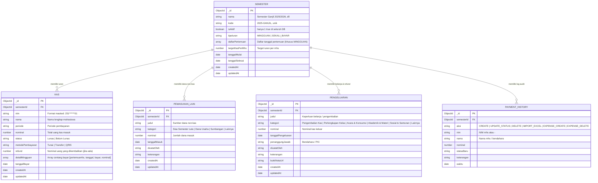

# 🗄️ Database Architecture, Schemas & Integrity Rules (`db.md`)

Dokumen spesifikasi arsitektur basis data MongoDB (Mongoose) untuk aplikasi **KasKita**. Dokumen ini mencakup model multi-semester, pencatatan kas mahasiswa (termasuk **Fitur Matriks Absensi Mingguan untuk Semester 1 & 2**), pemasukan non-kas, **pengeluaran kas kelas (termasuk modul Pengembalian Kas / Refund)**, dan log riwayat audit transaksi.

---

## 📌 Ringkasan Solusi Desain

1. **Dual Mode Iuran (Mingguan vs Sekali Bayar)**:
   * **Semester 1 & 2**: Menganut model `tipeIuran: "MINGGUAN"`. Setiap mahasiswa memiliki rincian riwayat centang bayar per pertemuan mingguan (`detailMingguan`).
   * **Semester 3 ke Atas**: Menganut model `tipeIuran: "SEKALI_BAYAR"`. Pembayaran dilakukan flat (1 atau 2 kali saat UTS/UAS), tidak memerlukan kolom mingguan.
2. **Pemisahan Uang Non-Iuran**:
   * Uang yang masuk bukan dari iuran mingguan (Sisa Saldo Kas Lalu, Sponsor, Dana Usaha, Sisa Seminar) **TIDAK DICAMPUR** ke kolom absensi mahasiswa, melainkan dicatat murni di koleksi **`PemasukanLain`**.
3. **Pengembalian Kas (Refund - Opsi 1)**:
   * Uang sisa kas yang dikembalikan ke mahasiswa dicatat resmi di koleksi **`Pengeluaran`** dengan kategori **`"Pengembalian Kas"`**.

---

## 1. Diagram Relasi Entitas (ERD)



---

## 2. Definisi Skema Mongoose (`src/models/`)

### A. Model Semester (`src/models/Semester.js`)
```javascript
const mongoose = require("mongoose");

const pertemuanSubSchema = new mongoose.Schema(
  {
    pertemuanKe: { type: Number, required: true },
    tanggal: { type: String, required: true }, // Format tampilan: "07/03" atau "YYYY-MM-DD"
    label: { type: String, default: "" },      // Label opsional: "Minggu 1", "UTS", "UAS"
  },
  { _id: false }
);

const semesterSchema = new mongoose.Schema(
  {
    nama: {
      type: String,
      required: [true, "Nama semester wajib diisi"],
      trim: true,
    },
    kode: {
      type: String,
      required: [true, "Kode semester wajib diisi"],
      unique: true,
      trim: true,
      uppercase: true,
    },
    isAktif: {
      type: Boolean,
      default: false,
      index: true,
    },
    tipeIuran: {
      type: String,
      enum: ["MINGGUAN", "SEKALI_BAYAR"],
      default: "SEKALI_BAYAR",
    },
    daftarPertemuan: [pertemuanSubSchema], // Terisi untuk Semester 1 & 2, kosong untuk Semester 3
    targetKasPerMhs: {
      type: Number,
      required: [true, "Target kas per mahasiswa wajib diisi"],
      min: [0, "Target kas tidak boleh negatif"],
      default: 0,
    },
    tanggalMulai: {
      type: Date,
      required: [true, "Tanggal mulai wajib diisi"],
    },
    tanggalSelesai: {
      type: Date,
      required: [true, "Tanggal selesai wajib diisi"],
    },
  },
  { timestamps: true }
);

module.exports = mongoose.models.Semester || mongoose.model("Semester", semesterSchema);
```

---

### B. Model Kas Mahasiswa (`src/models/Kas.js`)
> [!IMPORTANT]
> Ditambahkan field opsional `detailMingguan` untuk menampung riwayat absensi mingguan per pertemuan (Semester 1 & 2), dan `refund` untuk pencatatan nominal pengembalian kas per mahasiswa.

```javascript
const mongoose = require("mongoose");

const detailMingguanSubSchema = new mongoose.Schema(
  {
    pertemuanKe: { type: Number, required: true },
    tanggal: { type: String, required: true },
    bayar: { type: Boolean, default: false },   // true = centang hijau ✓, false = strip -
    nominal: { type: Number, default: 5000 },
  },
  { _id: false }
);

const kasSchema = new mongoose.Schema(
  {
    semesterId: {
      type: mongoose.Schema.Types.ObjectId,
      ref: "Semester",
      required: [true, "Semester wajib ditentukan"],
      index: true,
    },
    nim: {
      type: String,
      required: [true, "NIM wajib diisi"],
      trim: true,
    },
    nama: {
      type: String,
      required: [true, "Nama wajib diisi"],
      trim: true,
    },
    periode: {
      type: String,
      required: [true, "Periode wajib diisi"],
      trim: true,
    },
    nominal: {
      type: Number,
      required: [true, "Nominal wajib diisi"],
      min: [0, "Nominal tidak boleh negatif"],
    },
    status: {
      type: String,
      required: [true, "Status wajib diisi"],
      enum: {
        values: ["Lunas", "Belum Lunas"],
        message: "Status harus Lunas atau Belum Lunas",
      },
    },
    metodePembayaran: {
      type: String,
      enum: ["Transfer", "QRIS", "Tunai"],
      default: "Tunai",
    },
    refund: {
      type: Number,
      default: 0,
      min: [0, "Refund tidak boleh negatif"],
    },
    detailMingguan: {
      type: [detailMingguanSubSchema],
      default: [], // Kosong untuk semester sekali bayar (Semester 3 ke atas)
    },
    tanggalBayar: {
      type: Date,
      default: Date.now,
    },
  },
  { timestamps: true }
);

kasSchema.index({ semesterId: 1, nim: 1, periode: 1 });

module.exports = mongoose.models.Kas || mongoose.model("Kas", kasSchema);
```

---

### C. Model Pengeluaran Kas (`src/models/Pengeluaran.js`)
```javascript
const mongoose = require("mongoose");

const VALID_KATEGORI_PENGELUARAN = [
  "Pengembalian Kas",       // Pengembalian sisa kas ke mahasiswa di akhir semester (Refund)
  "Perlengkapan Kelas",     // Spidol, kabel, colokan, pengharum
  "Acara & Konsumsi",       // Air minum dosen, konsumsi kelas
  "Akademik & Materi",      // Print absen, fotokopi modul
  "Sosial & Santunan",      // Sumbangan duka/sakit
  "Lainnya",
];

const pengeluaranSchema = new mongoose.Schema(
  {
    semesterId: {
      type: mongoose.Schema.Types.ObjectId,
      ref: "Semester",
      required: [true, "Semester wajib ditentukan"],
      index: true,
    },
    judul: {
      type: String,
      required: [true, "Judul pengeluaran wajib diisi"],
      trim: true,
    },
    kategori: {
      type: String,
      enum: {
        values: VALID_KATEGORI_PENGELUARAN,
        message: "Kategori pengeluaran tidak valid",
      },
      default: "Lainnya",
    },
    nominal: {
      type: Number,
      required: [true, "Nominal pengeluaran wajib diisi"],
      min: [1, "Nominal pengeluaran minimal Rp 1"],
    },
    tanggalPengeluaran: {
      type: Date,
      default: Date.now,
    },
    penanggungJawab: {
      type: String,
      required: [true, "Penanggung jawab wajib diisi"],
      trim: true,
    },
    dicatatOleh: {
      type: String,
      default: "Bendahara",
      trim: true,
    },
    keterangan: {
      type: String,
      trim: true,
      default: "",
    },
    buktiNotaUrl: {
      type: String,
      trim: true,
      default: "",
    },
  },
  { timestamps: true }
);

pengeluaranSchema.index({ semesterId: 1, tanggalPengeluaran: -1 });

module.exports = mongoose.models.Pengeluaran || mongoose.model("Pengeluaran", pengeluaranSchema);
```

---

### D. Model Pemasukan Lain (`src/models/PemasukanLain.js`)
```javascript
const mongoose = require("mongoose");

const pemasukanLainSchema = new mongoose.Schema(
  {
    semesterId: {
      type: mongoose.Schema.Types.ObjectId,
      ref: "Semester",
      required: [true, "Semester wajib ditentukan"],
      index: true,
    },
    judul: {
      type: String,
      required: [true, "Judul pemasukan lain wajib diisi"],
      trim: true,
    },
    kategori: {
      type: String,
      enum: {
        values: ["Sisa Semester Lalu", "Dana Usaha", "Sumbangan", "Lainnya"],
        message: "Kategori pemasukan lain tidak valid",
      },
      default: "Lainnya",
    },
    nominal: {
      type: Number,
      required: [true, "Nominal wajib diisi"],
      min: [1, "Nominal minimal Rp 1"],
    },
    tanggalMasuk: {
      type: Date,
      default: Date.now,
    },
    dicatatOleh: {
      type: String,
      default: "Bendahara",
      trim: true,
    },
    keterangan: {
      type: String,
      trim: true,
      default: "",
    },
  },
  { timestamps: true }
);

pemasukanLainSchema.index({ semesterId: 1, tanggalMasuk: -1 });

module.exports = mongoose.models.PemasukanLain || mongoose.model("PemasukanLain", pemasukanLainSchema);
```

---

### E. Model Audit Riwayat (`src/models/PaymentHistory.js`)
```javascript
const mongoose = require("mongoose");

const paymentHistorySchema = new mongoose.Schema(
  {
    semesterId: {
      type: mongoose.Schema.Types.ObjectId,
      ref: "Semester",
      required: true,
      index: true,
    },
    aksi: {
      type: String,
      required: true,
      enum: [
        "CREATE",
        "UPDATE_STATUS",
        "DELETE",
        "IMPORT_EXCEL",
        "EXPENSE_CREATE",
        "EXPENSE_DELETE",
      ],
    },
    nim: {
      type: String,
      default: "-",
    },
    nama: {
      type: String,
      required: true,
    },
    nominal: {
      type: Number,
      default: 0,
    },
    statusBaru: {
      type: String,
      default: "",
    },
    keterangan: {
      type: String,
      default: "",
    },
    waktu: {
      type: Date,
      default: Date.now,
    },
  },
  { timestamps: false }
);

paymentHistorySchema.index({ semesterId: 1, waktu: -1 });

module.exports = mongoose.models.PaymentHistory || mongoose.model("PaymentHistory", paymentHistorySchema);
```

---

## 3. Aturan Integritas Data (Integrity Rules)

1. **Aturan Sinkronisasi Absensi Mingguan**:
   * Jika bendahara mencentang/membatalkan centang pada `detailMingguan`:
     $$\text{Nominal Kas Baru} = \sum (\text{Nominal Pertemuan yang } \text{bayar} == \text{true})$$
   * Status kelunasan di-update secara reaktif:
     $$\text{Status} = \begin{cases} \text{"Lunas"}, & \text{jika } \text{Nominal Kas} \ge \text{Target Kas Semester} \\ \text{"Belum Lunas"}, & \text{sebaliknya} \end{cases}$$

2. **Aturan Pemisahan Pemasukan Non-Iuran**:
   * Pemasukan seperti *Sisa Saldo Kas Lalu* atau *Sisa Seminar* **hanya disimpan di koleksi `PemasukanLain`**.
   * Hal ini menjamin bahwa jumlah total kolom absensi mahasiswa murni berasal dari iuran kelas.

3. **Kalkulasi Saldo Kas Konsolidasi**:
   $$\text{Total Pemasukan} = \sum (\text{Kas Mahasiswa}) + \sum (\text{Pemasukan Lain})$$
   $$\text{Total Pengeluaran} = \sum (\text{Pengeluaran Belanja}) + \sum (\text{Pengeluaran Refund})$$
   $$\text{Saldo Kas Riil} = \text{Total Pemasukan} - \text{Total Pengeluaran}$$
